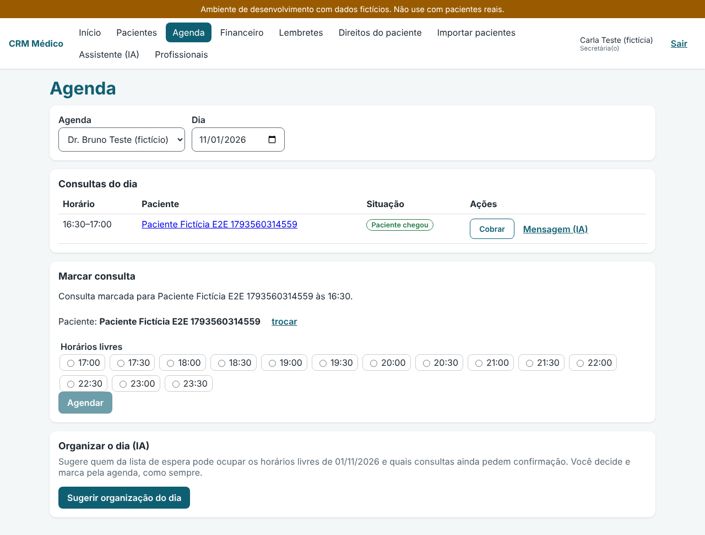
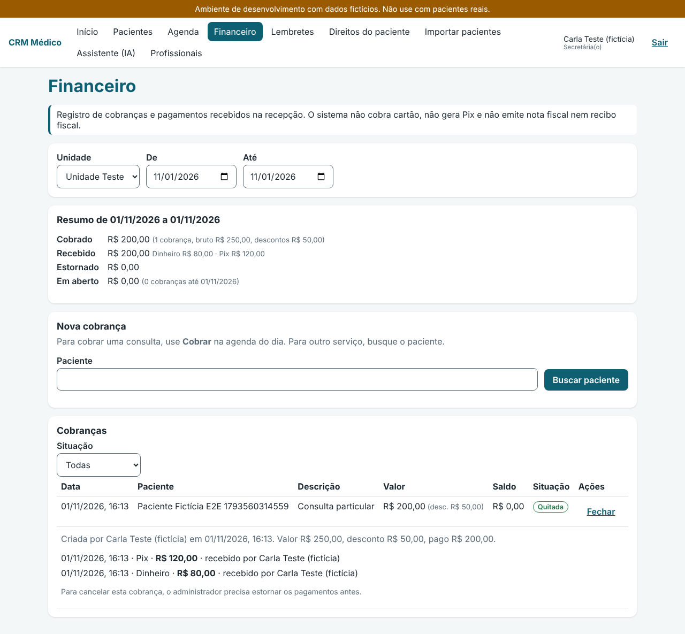
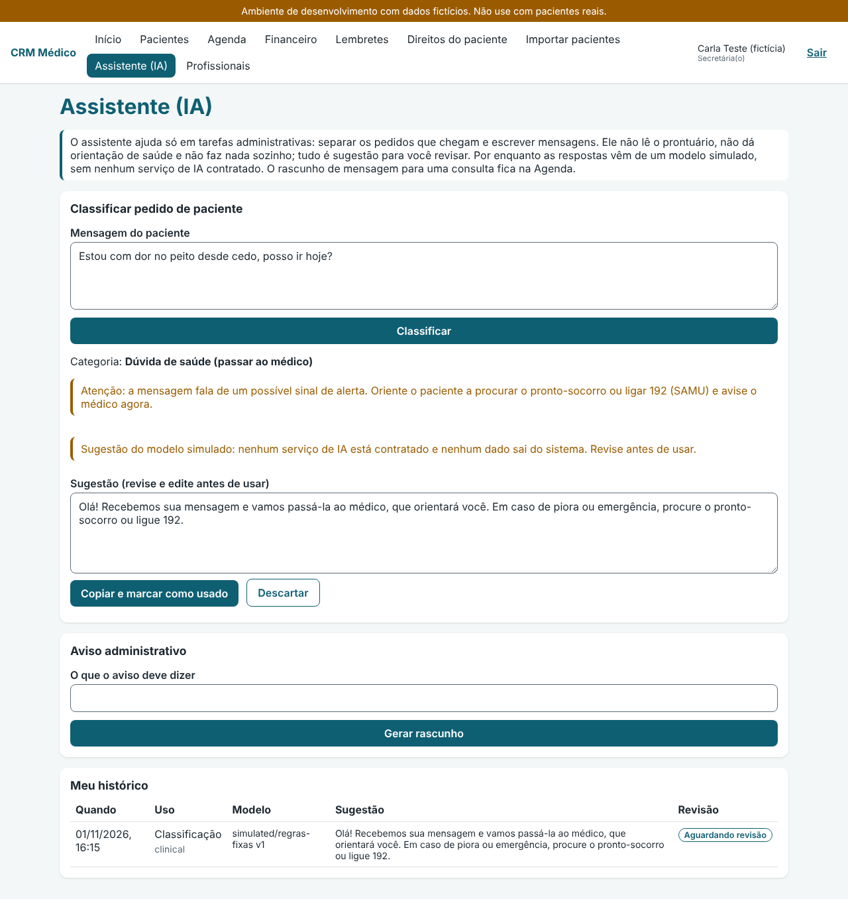
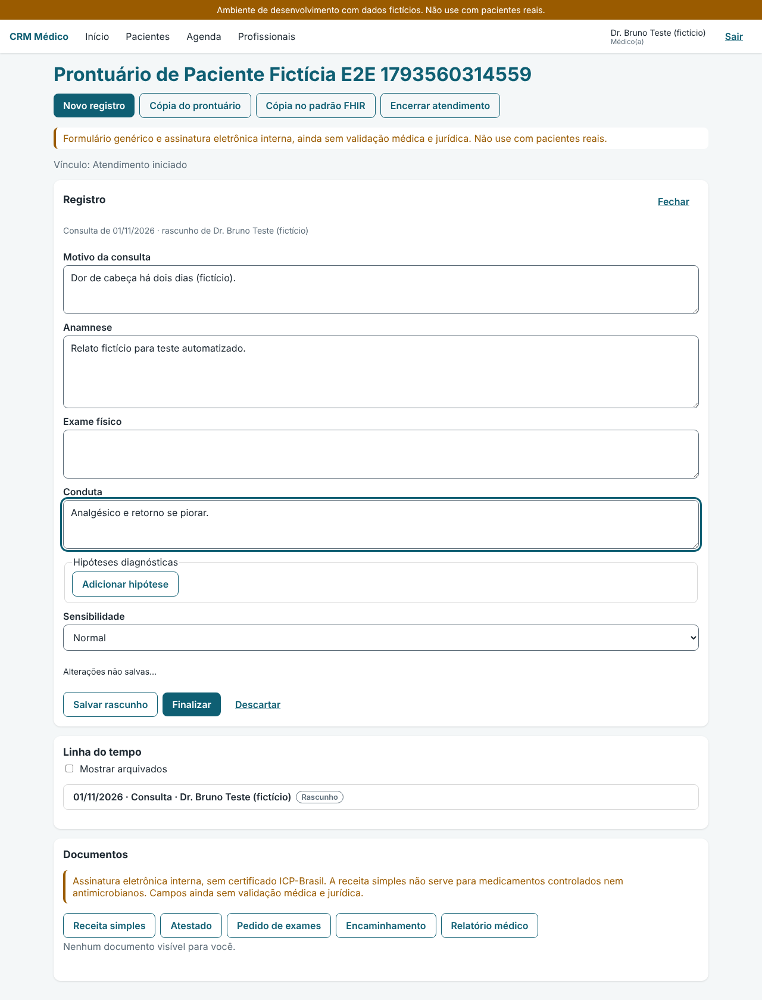
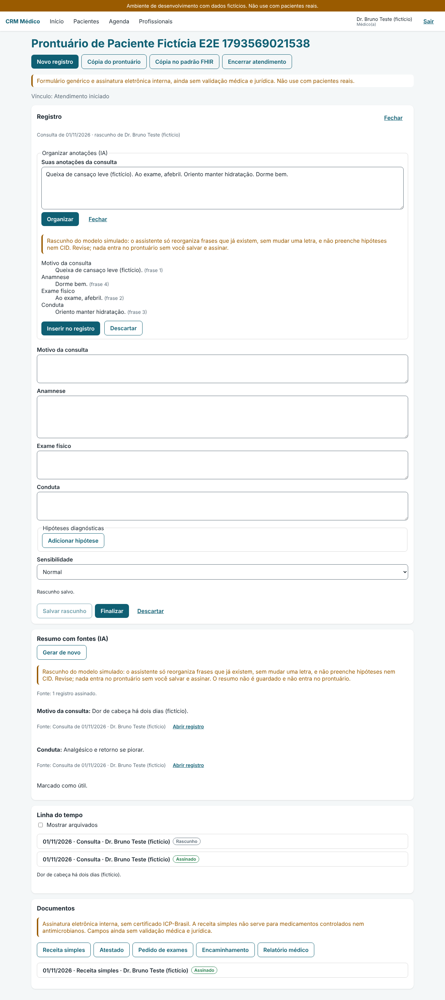

# Guia de uso do CRM Médico

Este guia explica, em passos simples, como a secretária, o médico e o administrador usam o
sistema no dia a dia. Para detalhes de cada regra, siga os links para `docs/api/`.

> **Atenção:** esta versão é um protótipo (MVP) e roda só com **dados fictícios**. Ela **não está
> pronta para uso com pacientes reais**: o prontuário e os documentos ainda precisam de
> validação médica e jurídica, a assinatura é interna (sem certificado ICP-Brasil), o envio pelo
> WhatsApp é simulado e o assistente de IA usa um modelo simulado. A faixa amarela no topo da
> tela lembra disso o tempo todo.
>
> As imagens deste guia vêm dos testes automáticos, com nomes e valores inventados.

## Sumário

1. [Para todos](#1-para-todos)
2. [Secretária](#2-secretária)
3. [Médico](#3-médico)
4. [Administrador](#4-administrador)
5. [Dúvidas comuns](#5-dúvidas-comuns)

## 1. Para todos

### Entrar no sistema

1. Abra o endereço do sistema no navegador (no ambiente de teste, `http://localhost:5173`).
2. Digite seu e-mail e sua senha e aperte **Entrar**.
3. **Médico e administrador** também digitam o código de 6 dígitos do aplicativo autenticador
   do celular. No primeiro acesso, a tela mostra um código QR para cadastrar o aplicativo
   (Google Authenticator, Microsoft Authenticator ou similar). Quem não puder usar a câmera
   digita a chave que aparece embaixo do código QR.
4. Se o administrador criou ou redefiniu seu acesso, a primeira coisa que o sistema pede é uma
   senha nova.

Esqueceu a senha? Peça ao administrador para **redefinir o acesso**. Depois de 5 senhas erradas
seguidas, a conta fica bloqueada por 15 minutos.

### Andar pelo sistema

- O **menu** no topo muda conforme o seu perfil: cada pessoa vê só o que usa no trabalho. Mesmo
  que alguém digite o endereço de uma tela que não é do seu perfil, o sistema nega o acesso.
- Seu nome e seu perfil ficam no canto direito, ao lado de **Sair**.
- Quem usa teclado aperta `Tab` uma vez ao abrir a página para achar o atalho **Pular para o
  conteúdo**.
- A sessão termina depois de 30 minutos sem uso, ou 12 horas no total. Aí é só entrar de novo.

### Confirmar a identidade em ações importantes

Assinar, estornar, exportar dados, mudar acessos e ligar o assistente de IA pedem **a sua senha
de novo** (e o código, para quem usa). A confirmação vale por 5 minutos. Isso protege o sistema
se alguém usar um computador que ficou aberto.

## 2. Secretária

O menu da secretária tem: Início, Pacientes, Agenda, Financeiro, Lembretes, Direitos do
paciente, Importar pacientes, Assistente (IA) e Profissionais.

### Cadastrar e encontrar pacientes

1. Em **Pacientes**, busque por nome, CPF ou telefone e aperte **Buscar**.
2. Se não achar, aperte **Novo paciente** e preencha nome completo, data de nascimento e
   telefone com DDD. Nome social e CPF são opcionais. Marque **Este telefone tem WhatsApp**
   quando for o caso.
3. Aperte **Cadastrar**. Se o sistema avisar que **encontrou cadastros parecidos**, confira a
   lista. Se tiver certeza de que é outra pessoa, envie de novo.
4. Na ficha, o CPF aparece mascarado. A ficha também mostra se o paciente **autoriza os
   lembretes** pelo WhatsApp, os pedidos de direitos e o relatório de acessos.

### Marcar e acompanhar consultas

1. Na ficha do paciente, aperte **Agendar consulta**. Ou vá em **Agenda** e use **Buscar
   paciente** no quadro **Marcar consulta**.
2. Escolha a agenda do médico, o dia e um dos **horários livres**, e aperte **Agendar**.
3. No dia, a lista **Consultas do dia** mostra cada consulta com a situação. Use os botões da
   linha:
   - **Confirmar**, quando o paciente confirmar;
   - **Registrar chegada**, quando ele chegar (só então o médico pode iniciar o atendimento);
   - **Cancelar**, informando o motivo;
   - **Cobrar**, para criar a cobrança da consulta;
   - **Mensagem (IA)**, para um rascunho de confirmação, remarcação ou falta (veja
     [Assistente](#usar-o-assistente-ia)).

### Cobrar e receber (só particular)

O sistema **registra** cobranças e pagamentos feitos na recepção. Ele não cobra cartão, não gera
Pix e não emite nota fiscal. Não há convênios: só atendimento particular.

1. Para uma consulta, aperte **Cobrar** na agenda. Para outro serviço, vá em **Financeiro**,
   busque o paciente em **Nova cobrança** e escolha um item da tabela de preços (ou digite a
   descrição e o valor). O desconto é opcional.
2. Abra a cobrança e use **Registrar pagamento** com a forma e o valor recebido. Dá para
   receber em partes (por exemplo, parte em Pix e parte em dinheiro).
3. Se clicar duas vezes por engano, o sistema não lança o pagamento em dobro.
4. Uma cobrança sem pagamento pode ser cancelada com motivo. Com pagamento, só o administrador
   estorna.
5. O **Resumo** mostra, para a unidade e o período escolhidos, quanto foi cobrado, recebido
   (por forma), estornado e o que está em aberto.

Regras: [financeiro.md](../api/financeiro.md).

### Lembretes pelo WhatsApp

- Em **Lembretes**, veja os lembretes de consulta na fila, enviados, que falharam e cancelados,
  com o texto exato que vai para o paciente.
- Um lembrete na fila pode ser cancelado com motivo.
- O lembrete só sai se, na ficha, o paciente **autorizou** receber lembretes.
- Por enquanto o envio é **simulado**: nada sai de verdade até a clínica contratar um serviço de
  WhatsApp autorizado.

Regras: [crm-e-lembretes.md](../api/crm-e-lembretes.md).

### Pedidos do paciente sobre os próprios dados (LGPD)

1. Na ficha do paciente (ou em **Direitos do paciente**), registre o pedido: acesso aos dados,
   relatório de quem acessou, correção, cópia em formato aberto, eliminação, com quem foi
   compartilhado ou outro.
2. A lista mostra primeiro os pedidos abertos, com o **prazo de 15 dias** e o aviso de vencido.
3. Para responder, escolha **atendido** ou **negado** e escreva a resposta dada ao paciente. A
   resposta **não pode ser desfeita**.
4. Na ficha, o **relatório de acessos** mostra quem viu os dados, quando e o quê (sem conteúdo
   clínico) e pode ser impresso. **Exportar os dados** gera um arquivo e pede a sua senha,
   porque o arquivo traz o CPF. A cópia do prontuário é feita pelo médico.

Regras: [direitos-do-titular.md](../api/direitos-do-titular.md).

### Importar pacientes de uma planilha

1. Em **Importar pacientes**, baixe o **modelo** e preencha uma linha por paciente.
2. Escolha o arquivo CSV. O sistema mostra cada linha como pronta, com erro (e em qual coluna)
   ou possível duplicidade, **sem gravar nada**.
3. Aperte **Importar**: só as linhas prontas entram. Os pacientes importados entram **sem**
   autorização de lembretes ou marketing, que precisa ser registrada depois na ficha.

### Usar o assistente (IA)

O assistente só funciona se o administrador ligou a função. Tudo o que ele produz é
**rascunho**: você lê, corrige se precisar e decide.

- Em **Assistente (IA)**, cole a mensagem de um paciente em **Mensagem do paciente** e aperte
  **Classificar**. O assistente sugere o assunto (marcar, remarcar, cancelar, pagamento,
  documentos, dúvida de saúde ou outro) e uma resposta administrativa.
- Se a mensagem falar de um **sinal de alerta** (por exemplo, dor no peito), aparece um aviso
  fixo: oriente o paciente a procurar o pronto-socorro ou ligar **192 (SAMU)** e avise o médico.
  O assistente **nunca** dá orientação de saúde.
- O assistente também escreve rascunhos de avisos administrativos e, na **Agenda**, o quadro
  **Organizar o dia (IA)** sugere quem da lista de espera pode ocupar cada horário livre e quais
  consultas pedem confirmação. Nada é marcado sozinho.
- Use **Copiar e marcar como usado** ou descarte a sugestão. O histórico mostra o que você já
  usou.

Regras: [ia-nivel-1.md](../api/ia-nivel-1.md).

## 3. Médico

O menu do médico tem: Início, Pacientes, Agenda e Profissionais. A agenda mostra só a dele.

### Atender e registrar no prontuário

1. Em **Agenda**, quando a secretária registrar a chegada, aperte **Iniciar atendimento** na
   linha do paciente. O prontuário abre com o vínculo **Atendimento iniciado**.
2. Aperte **Novo registro** e preencha motivo da consulta, anamnese, exame físico, conduta e,
   se quiser, hipóteses diagnósticas. Escolha a **sensibilidade** (por exemplo, para assuntos
   de saúde mental).
3. O rascunho é **salvo sozinho** alguns segundos depois de você parar de digitar. Se outra
   janela salvou antes, o sistema avisa e mantém o seu texto.
4. Aperte **Finalizar** quando o registro estiver pronto e depois **Assinar**, com a sua senha e
   o código. Depois de assinado, o registro não muda mais.
5. Para corrigir um registro assinado, use **Retificar** (substitui o anterior, que continua
   visível) ou **Adendo** (complementa sem substituir). Os dois pedem justificativa e
   assinatura.
6. Registros sensíveis de outro médico aparecem na linha do tempo sem o conteúdo. Para abrir, é
   preciso escrever uma justificativa, que fica gravada.
7. No fim, aperte **Encerrar atendimento**.

Regras: [prontuario.md](../api/prontuario.md) e
[atendimento-e-vinculo.md](../api/atendimento-e-vinculo.md).

### Assistente clínico (IA)

Só aparece quando o administrador liga a função em Configurações. Ele **não escreve texto
clínico**: só reorganiza as suas frases ou as de registros assinados, sem mudar uma letra, e
nunca preenche hipóteses nem CID. Por enquanto usa um modelo simulado.

- **Organizar anotações (IA)**, dentro do rascunho: escreva ou cole as anotações livres da
  consulta e aperte **Organizar**. Confira em que campo cada frase foi parar e as frases que
  ficaram de fora. **Inserir no registro** acrescenta o texto ao fim de cada campo; revise antes
  de finalizar e assinar, como sempre.
- **Resumo com fontes (IA)**, acima da linha do tempo: aperte **Gerar resumo**. Cada trecho
  mostra a data, o tipo e o autor do registro de onde veio, e **Abrir registro** leva até ele.
  Rascunhos e registros sensíveis de outro médico ficam de fora (a tela diz quantos). O resumo
  não é guardado.

Regras: [ia-nivel-2.md](../api/ia-nivel-2.md).

### Receitas, atestados e outros documentos

1. Na área **Documentos** do prontuário, escolha **Receita simples**, **Atestado**, **Pedido de
   exames**, **Encaminhamento** ou **Relatório médico**.
2. Preencha e aperte **Salvar rascunho**. Depois **Assine** com senha e código e use **Abrir
   PDF** para imprimir ou enviar.
3. A **receita simples não serve** para medicamentos controlados nem antimicrobianos.
4. Um documento assinado só pode ser cancelado pelo autor, com motivo.

Regras: [documentos.md](../api/documentos.md).

### Cópia do prontuário pedida pelo paciente

Com o vínculo valendo (atendimento iniciado, acompanhamento ou encerrado), aperte **Cópia do
prontuário** (arquivo JSON) ou **Cópia no padrão FHIR** (para levar a outro serviço de saúde).
O sistema confirma a sua senha e diz quantos registros entraram e se algum registro sensível de
outro profissional ficou de fora.

## 4. Administrador

O menu do administrador tem: Início, Financeiro, Profissionais, Auditoria e Configurações. Ele
não vê prontuários.

### Configurações

Toda mudança de acesso pede a sua senha e o código de novo.

- **Usuários:** crie contas com perfil (secretária, médico, administrador) e unidades. A senha
  temporária aparece **uma única vez**: entregue com cuidado. Também dá para redefinir o
  acesso, desativar e reativar contas.
- **Unidades e especialidades:** crie e desative.
- **Fichas profissionais:** para usuários com perfil Médico, cadastre CRM, UF, especialidade e
  RQE.
- **Agendas:** crie a agenda do médico numa unidade e ajuste os horários de atendimento por dia
  da semana. Para isso, você precisa estar vinculado à unidade.
- **Tabela de preços (particular):** crie itens, mude valores e desative.
- **Assistente de IA:** ligue ou desligue cada função. Você vê quanto cada pessoa usou, mas
  não o texto das sugestões.

### Financeiro

O administrador vê todas as cobranças e é quem **estorna** um pagamento, com motivo, senha e
código. O **Resumo assistido do período (IA)** escreve destaques usando só os números que o
sistema calculou, que aparecem ao lado para conferir.

### Auditoria

Em **Auditoria**, veja quem fez o quê e quando, filtre por resultado e use **Verificar a trilha**
para conferir se nenhum registro foi apagado ou alterado. A tela também mostra a fila de revisão
dos acessos emergenciais.

Regras: [auditoria.md](../api/auditoria.md).

## 5. Dúvidas comuns

**Não aparece um item no menu.** O menu depende do perfil. Se você precisa de uma tela, peça ao
administrador para revisar o seu perfil e as suas unidades.

**O sistema pediu a senha de novo.** É a confirmação de identidade das ações importantes. Ela
vale por 5 minutos.

**Errei um registro assinado.** Não dá para apagar: use **Retificar** ou **Adendo**, com
justificativa.

**O paciente quer saber quem viu os dados dele.** A secretária abre o **relatório de acessos**
na ficha do paciente.

**O lembrete não foi enviado.** Confira se o paciente autorizou os lembretes na ficha. Lembre
que, nesta versão, o envio é simulado.

**Posso usar com pacientes de verdade?** **Ainda não.** Antes disso faltam a validação médica e
jurídica, o teste de invasão e os testes com pessoas descritos no
[roteiro de testes](../revisao/roteiro-testes-com-pessoas.md).
